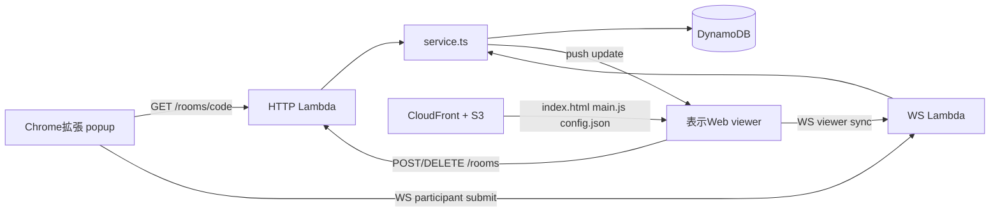
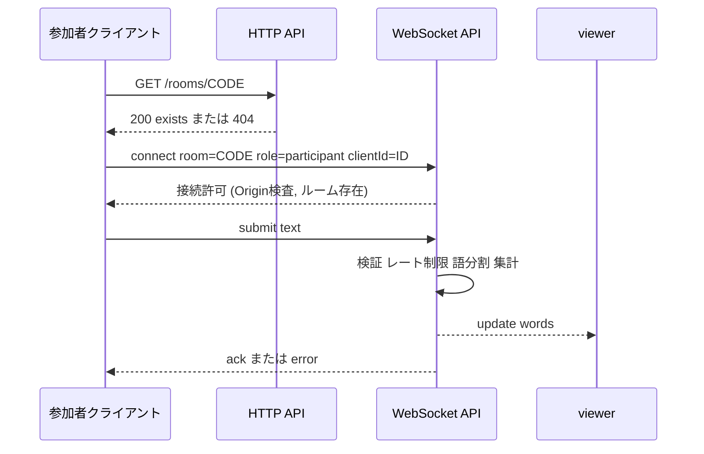

# Architecture

## Architecture Analysis

### System Overview
npm workspaces のモノレポ。ブラウザ側クライアント(web 表示画面、Chrome 拡張機能)と、AWS サーバーレスのバックエンド(HTTP API + WebSocket API + DynamoDB)で構成される。業務ロジックは `packages/server/src/service.ts` に集約され、Lambda とローカル開発サーバーが同じロジックを共有する。

### Architectural Style
サーバーレス(API Gateway + Lambda + DynamoDB + S3/CloudFront)。根拠: infra/lib/wordcloud-stack.ts。ロジックは Repository / Pusher の抽象で環境から分離される(ヘキサゴナル風)。

### Component Relationships

テキスト補足: 拡張機能は HTTP で部屋の存在確認、WebSocket で送信する。表示 Web は HTTP でルーム管理、WebSocket で更新を受ける。両 Lambda は service.ts を呼び、DynamoDB に保存する。静的ファイルは CloudFront/S3 から配信される。

### Data Flow
参加者 submit → 検証/サニタイズ → レート制限(clientId と接続の両方) → 語分割(kuromoji、ws Lambda のみ) → DynamoDB で語を加算 → viewer 全接続へ `update` を push → 送信者へ `ack`。

### Key Design Decisions
- 入力テキスト自体は保存もログ出力もしない(service.ts)。
- 主催者キーはハッシュのみ保存し、定数時間で比較する(core/room.ts)。
- CORS は Lambda 内で処理し、許可 Origin は ALLOWED_ORIGINS(CloudFront オリジン + chrome-extension://id)に限る。
- CloudFront の CSP は `script-src 'self'`(インライン JS 不可)、connect-src は同リージョンの execute-api のみ。
- クライアント設定は、配信元に置く `config.json`(apiUrl, wsUrl)で与える。

### Improvement Opportunities
- extension と web に重複するユーティリティ(parseConfig、backoffDelay、normalizeRoomCode)。
- CI/lint が無い(code-quality-assessment.md 参照)。

## Interaction Diagrams

### 拡張機能からの送信(モバイルフォームも同じ契約を使える)

テキスト補足: 参加者は存在確認後に WebSocket へ接続し、submit を送る。サーバーは集計して viewer へ update を push し、送信者へ ack(または error)を返す。
