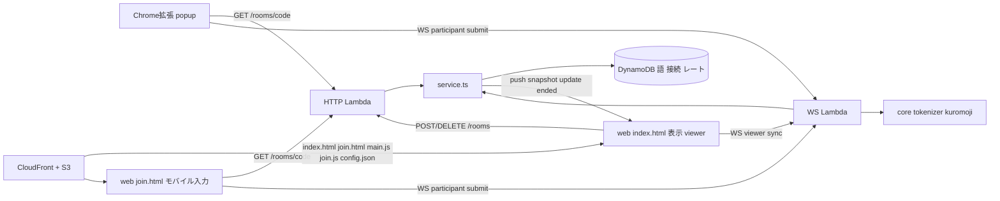
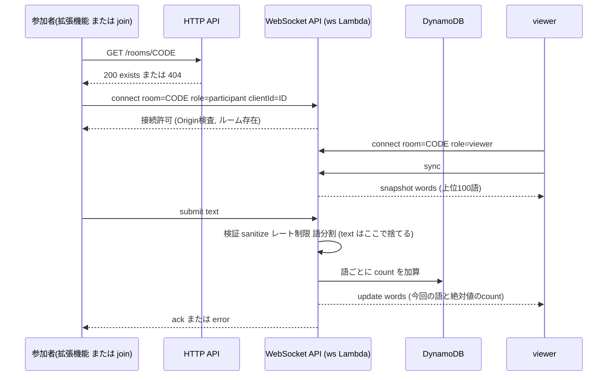
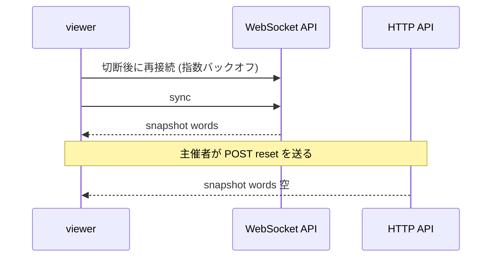

# Architecture

## Architecture Analysis

### System Overview
npm workspaces のモノレポ。ブラウザ側クライアント(web の表示画面と入力フォーム、Chrome 拡張機能)と、AWS サーバーレスのバックエンド(HTTP API + WebSocket API + DynamoDB)で構成される。業務ロジックは `packages/server/src/service.ts` に集約され、Lambda とローカル開発サーバー(local.ts)が同じロジックを共有する。

### Architectural Style
サーバーレス(API Gateway + Lambda + DynamoDB + S3/CloudFront)。根拠: infra/lib/wordcloud-stack.ts。ロジックは Repository / Pusher の抽象で環境から分離される(ヘキサゴナル風)。

### Component Relationships

テキスト補足: 拡張機能とモバイル入力フォームは、どちらも HTTP で部屋の存在確認、WebSocket で submit を送る(通信契約は同じで、join は extension の protocol.ts を再利用する)。表示 Web は HTTP でルーム管理、WebSocket で `snapshot`/`update` を受ける。両 Lambda は service.ts を呼び、語の集計を DynamoDB に保存する。語分割(kuromoji)は ws Lambda だけが持ち、http Lambda の tokenize は空を返す。

### Data Flow
参加者 submit → `parseClientMessage`(1024B 以内)→ 接続とルームの確認(participant のみ)→ `validateText`(100 コードポイント、sanitize)→ レート制限(clientId 単位と接続単位の両方)→ `tokenize`(kuromoji/英語、メッセージ内で重複除去)→ `repo.incrementWords`(語ごとの ADD)→ `listViewers` の全接続へ `update{words}` を push → 送信者へ `ack`。

- **`update` の中身**: 今回の submit で出た語だけ(`{word,count}`、count は加算後の絶対値)。元の文は含まない。viewer は `mergeWords` で絶対値を上書きする。
- **`snapshot`**: viewer が接続後に送る `sync` への応答(上位 100 語)と、リセット時の空配列。
- **文が捨てられる箇所**: `handleWsMessage`(service.ts)の中。`msg.text` と `v.text` は tokenize の入力にだけ使われ、その後は参照されない。Repository にテキストを受ける操作は無く、Lambda の `console.error` はエラー名だけを出す。
- **viewer の状態**: web/main.ts のモジュール変数 `words`(語と回数だけ)。履歴や一覧は無い。再接続すると `sync` で上位 100 語を取り直す。

### Viewer の画面構成(入力リストを足す場所)
- index.html の `#room`(`position:fixed; inset:0`、縦 flex)に `header.bar`、`svg#cloud`(`flex:1; min-height:0`)、重ね表示の `p#room-message` が並ぶ。
- 描画は `scheduleRender`(最短 1500ms 間隔)→ `renderCloud(svg, words, w, h)`(`svg.getBoundingClientRect()`、最小 300x200)。resize でも再描画する。`#cloud` の高さが変われば、既存の仕組みで再配置される。
- 文字列は `textContent` だけで設定する(NFR2.3)。CSP は `script-src 'self'`(インライン JS 不可)。

### Key Design Decisions
- 入力テキスト自体は保存もログ出力もしない(service.ts のコメントと service.test.ts の 1 件。検査の範囲は code-quality-assessment.md)。
- 主催者キーはハッシュのみ保存し、定数時間で比較する(core/room.ts)。
- CORS は Lambda 内で処理し、許可 Origin は ALLOWED_ORIGINS(CloudFront オリジン + chrome-extension://id)に限る。
- CloudFront の CSP は `script-src 'self'`、connect-src は同リージョンの execute-api のみ。
- クライアント設定は、配信元に置く `config.json`(apiUrl, wsUrl)で与える。
- ルーム内の全データ(語、接続、レート)は TTL 付きで保存し、読み取り時にも ttl を確認する。

### Improvement Opportunities
- extension と web に重複するユーティリティ(parseConfig、backoffDelay、normalizeRoomCode)。web の join-logic.ts が `../../extension/src/protocol.js` を相対 import している。
- viewer 描画(main.ts、cloud.ts、socket.ts)に自動テストが無い。
- CI/lint が無い(code-quality-assessment.md 参照)。

## Interaction Diagrams

### 参加者の送信から viewer の更新まで

テキスト補足: submit の本文は ws Lambda の中で語に分けられ、語と回数だけが DynamoDB と viewer に渡る。送信者には本文を含まない `ack` が返る。

### viewer の再接続とリセット

テキスト補足: viewer は再接続のたびに `sync` を送り、`snapshot` で語の集計を取り直す。リセットは HTTP 側から全 viewer へ空の `snapshot` を送る。
