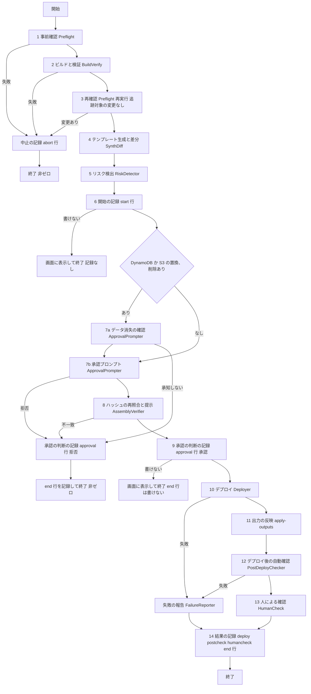

# 論理コンポーネント

承認つきデプロイスクリプト(TypeScript、`npm run` から実行)の構成。新しく作るのは、このスクリプトだけである。AWS 上の既存スタック(`WordcloudStack`)の構成は変えない。

## 実行の流れ

テキスト補足: 事前確認、ビルドと検証、再確認、テンプレート生成と差分、リスク検出、開始の記録、(必要なら)データ消失の確認、承認プロンプト、ハッシュの再照合と提示、承認の判断の記録、デプロイ、出力の反映、自動確認、人による確認、結果の記録の順に進む。承認プロンプトの後は、必ず承認の判断を承認ログに記録してからデプロイに進む。記録の規則は次のとおり。

- `start` 行を書く前に中止したとき(事前確認、ビルドと検証、再確認の失敗)は、`abort` 行だけを書く。
- `start` 行を書いた後に止まったとき(承認の拒否、データ消失の確認の拒否、ハッシュの不一致)は、`approval` 行と `end` 行を書く。
- 承認ログに書けないとき(`start` 行、`approval` 行の書き込みの失敗)は、記録を残せないため、理由を画面に表示して非ゼロで終了する。この場合は、デプロイしない。画面の表示が唯一の記録になる。
- デプロイを始めた後の失敗は、`deploy` 行などの結果の行と `end` 行を書く。

## コンポーネント

| コンポーネント | 責務 | 関連する要件 |
|---|---|---|
| Preflight | 作業ツリーに未コミットの変更がないこと、アカウント(STS)とリージョン、CDKToolkit のブートストラップ、`WordcloudStack` の状態(更新できる状態)を確認する。ビルドと検証の後に、追跡対象のファイルが変わっていないことだけを再確認する(ステップ 3) | FR3.7、NFR1.2、NFR2.2 |
| BuildVerify | ビルド、型検査、テストを順に実行し、失敗したら止める | FR3.4、NFR1.3、NFR4.1、NFR4.2、NFR6.1 |
| SynthDiff | テンプレートを一度だけ生成して保存し、同じものを使って差分を表示する。保存したテンプレート一式のハッシュを計算して、承認の対象とする | FR3.2、NFR1.1 |
| RiskDetector | 差分から、DynamoDB と S3 の置換、削除を検出する | FR3.6、FR2.3 |
| ApprovalPrompter | データ消失の確認と、承認プロンプトを出す。回答は明示的な入力だけを有効とする | FR3.2、FR3.6、NFR1.1 |
| AssemblyVerifier | 承認の後、デプロイの前に、保存したテンプレート一式のハッシュを計算し直し、承認時のハッシュと照合する。結果(承認時のハッシュ、現在のハッシュ、一致か不一致か)を、開発者に画面で提示する。不一致のときはデプロイしない | NFR1.1、FR3.2 |
| ApprovalLog | 承認ログに追記する。書けないときは呼び出し元に失敗を返す。行の種類は `abort`、`start`、`approval`、`deploy`、`postcheck`、`humancheck`、`end` | FR3.5、NFR1.4、NFR2.4、NFR2.5 |
| Deployer | 保存したテンプレートを `cdk deploy` に渡してデプロイする。`--require-approval never` は付けず、CDK の既定の確認(IAM などの権限が広がる変更)をそのまま残す。人が CDK の確認で拒否したときは、デプロイは中止される | FR6.1、NFR1.1 |
| PostDeployChecker | HTTP API の応答と表示用 Web の取得を、再試行つきで確認する | FR5.1、NFR3.6 |
| HumanCheck | 画面表示、WebSocket の接続、送信から表示までの動作を、人に 1 項目ずつ尋ねて記録する | FR5.3、FR5.4、FR5.5、NFR1.5 |
| FailureReporter | スタックの状態、失敗したリソースとその理由を表示する | FR6.2、NFR5.6、NFR5.7 |
| AwsCli | AWS CLI を子プロセスとして呼ぶ薄い層。認証情報を出力しない | Q7、NFR2.3 |
| StepTimer | 各ステップの開始、終了、所要時間を表示する | NFR3.1、NFR3.4 |

## 障害の範囲(failure domain)

| 障害 | 影響の範囲 | 扱い |
|---|---|---|
| 事前確認の失敗(認証切れ、ブートストラップなし、スタックが更新不可) | AWS を変更する前なので、影響なし | 停止して原因を表示し、`abort` 行を記録する |
| ビルド、型検査、テストの失敗 | AWS を変更する前なので、影響なし | 停止して `abort` 行を記録する |
| ビルド後に追跡対象のファイルが変わった | AWS を変更する前なので、影響なし | 停止して `abort` 行を記録する |
| 承認ログに書けない(`start` 行または `approval` 行) | AWS を変更する前に検出する | デプロイしない。理由を画面に表示して非ゼロで終了する(記録は残せない) |
| ハッシュの不一致 | AWS を変更する前に検出する | デプロイしない。不一致を提示して `approval` 行と `end` 行に記録する |
| デプロイ中の失敗 | `WordcloudStack` のみ。ほかのスタックには及ばない | スタックの状態を表示。CloudFormation が自動でロールバックする |
| デプロイ後の自動確認の失敗 | デプロイは完了済み | 失敗として報告する。自動のロールバックはしない |

影響の最大は、DynamoDB と S3 の置換による本番データの消失であり、RiskDetector と ApprovalPrompter の 2 段の確認で守る。

## 共有リソース

- 承認ログのファイル(リポジトリ内、git 管理外)。ApprovalLog だけが書く。
- 保存したテンプレートのディレクトリ(`cdk.out` 系、git 管理外)。SynthDiff が作り、AssemblyVerifier と Deployer が読む。

## Sources

- `aidlc/spaces/default/intents/261123-aws-deploy/inception/requirements-analysis/requirements.md`(FR2、FR3、FR5、FR6)
- `aidlc/spaces/default/intents/261123-aws-deploy/construction/nfr-requirements/`(六つの文書)
- `nfr-design-questions.md`(Q1 から Q7)

## Assumptions & Open Questions

- Assumptions: 保存したテンプレートのディレクトリを `cdk deploy` に渡せる(CDK の cloud assembly を直接デプロイする機能を使う)。実装時に確認する。
- Open questions: None.
